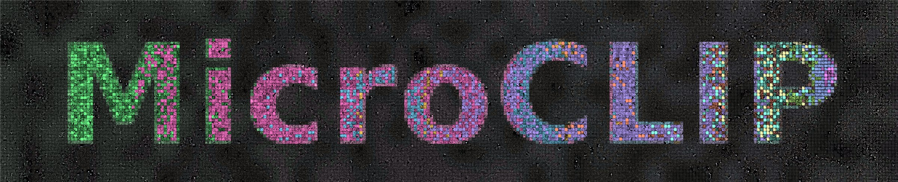
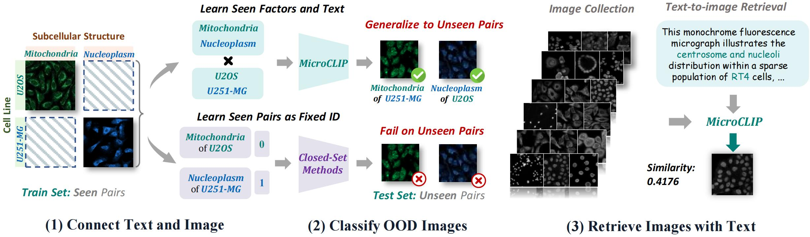
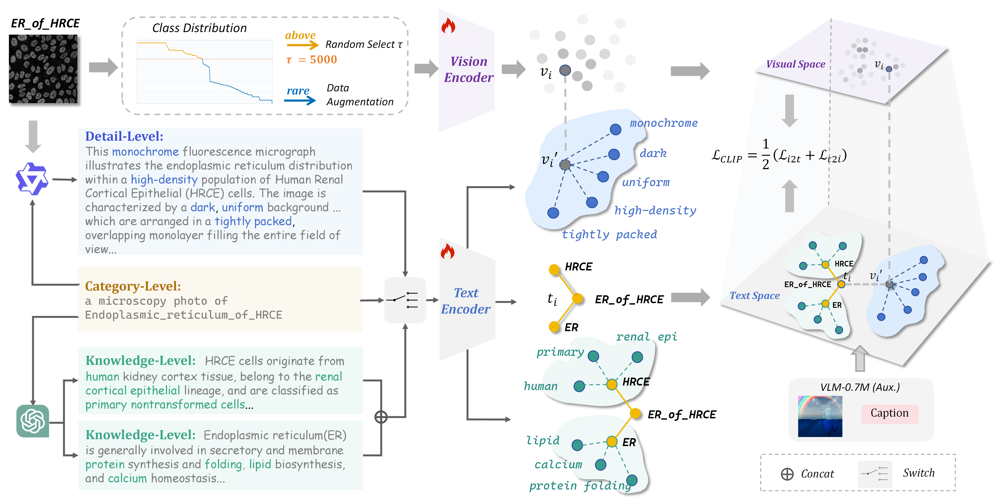

<div align="center">
  
  <h1>MicroCLIP</h1>
  <p><strong>Connecting Text and Microscopy Images<br>via Contrastive Language–Image Pretraining</strong></p>
  <p>Describe the biology. Search the cells.</p>
  <p>
    <a href="https://arxiv.org/abs/2610.17866"></a>
    <a href="https://y2r-mv1p.github.io/MicroCLIP/"></a>
    <a href="https://github.com/Y2R-mv1p/MicroCLIP"></a>
  </p>
  <p>
    <a href="#highlights">Highlights</a> ·
    <a href="#results">Results</a> ·
    <a href="#quickstart">Quickstart</a> ·
    <a href="#micropool-2m">Dataset</a> ·
    <a href="#method-overview">Method</a> ·
    <a href="#training">Training</a> ·
    <a href="#evaluation">Evaluation</a> ·
    <a href="https://y2r-mv1p.github.io/MicroCLIP/">Project page</a>
  </p>
</div>

<p align="center">
  <a href="https://y2r-mv1p.github.io/MicroCLIP/"></a>
</p>

**We introduce MicroCLIP for language-guided recognition and retrieval in single-channel fluorescence microscopy.** We initialize both encoders from DFN2B-CLIP ViT-B/16 and train on approximately **2.5 million microscopy images** to learn a shared representation of microscopy appearance, subcellular structures, and cell-line semantics.

<p align="center">
  
</p>

<p align="center"><em>Learn biological factors from seen pairs. Recognize unseen combinations. Retrieve images with text.</em></p>

## Highlights

| Recognize cells | Generalize across combinations | Search with language | Compact dual encoder |
|:---:|:---:|:---:|:---:|
| **98.46%** IID Top-1 | **67.70%** compositional Top-1 | **63.3%** text-to-image Recall@1 | **150M** parameters |
| 59 candidate categories | 64 held-out structure–cell-line pairs | 1,000 image–caption candidates | ViT-B/16 · 256-token context |

- **Specify recognition targets with text.** Rank candidate structure–cell-line categories without fitting a task-specific classifier.
- **Recognize combinations absent from training.** On Compositional Shift, MicroCLIP reaches **67.70%**, versus **5.12%** for the strongest evaluated general-purpose VLM.
- **Retrieve in both directions.** Search micrographs using descriptions, or find descriptions for a query image: **61.5% I2T / 63.3% T2I Recall@1**.
- **Train with three complementary views of biology.** Category identities, image-level visual details, and biological knowledge provide complementary text supervision.

We report these results in our experiments. Classification ranks candidates **within each evaluation subset**; 98.46% is measured on the 59-category IID subset.

## Results

Classification is **Top-1 accuracy (%)**. Retrieval is **Recall@1 (%)** over **1,000 held-out image–caption pairs**, using detail-level captions. We evaluate general-purpose VLMs using their released weights and native configurations, without microscopy adaptation or prompt ensembling.

| Method | Params | IID | Compositional | Cell-Line | Organelle-Set | Source Shift | I2T | T2I |
|---|---:|---:|---:|---:|---:|---:|---:|---:|
| Fully supervised classifier | — | 97.74 | — | — | — | — | — | — |
| Cell-DINO | 304M | 36.06 | 0.98 | — | — | — | — | — |
| CLIP (OpenAI ViT-B/16) | 150M | 2.97 | 5.12 | 1.80 | 2.54 | 8.38 | 0.7 | 0.2 |
| SigLIP (ViT-B/16) | 203M | 3.05 | 1.88 | 1.07 | 1.26 | 9.33 | 0.2 | 0.2 |
| SigLIP 2 (ViT-B/16) | 375M | 3.08 | 2.28 | 3.59 | 1.11 | 10.79 | 0.2 | 0.3 |
| PE-Core (ViT-B/16) | 448M | 3.34 | 3.78 | 7.63 | 2.19 | 22.54 | 0.4 | 0.0 |
| DFN2B-CLIP (ViT-B/16) | 150M | 1.44 | 1.41 | 4.32 | 0.81 | 16.49 | 0.5 | 0.1 |
| **MicroCLIP** | **150M** | **98.46** | **67.70** | **34.07** | **46.13** | **36.53** | **61.5** | **63.3** |

CLIP, SigLIP, SigLIP 2, PE-Core, and DFN2B-CLIP are **general-domain vision–language foundation models**. We develop MicroCLIP as a **microscopy-domain vision–language foundation model** for single-channel fluorescence microscopy, initializing both encoders from DFN2B-CLIP and training on microscopy image–text pairs. The comparison therefore evaluates general-domain models alongside our microscopy-domain model on microscopy recognition and retrieval tasks.

The supervised classifier and Cell-DINO use different evaluation protocols from text-guided zero-shot methods. Source Shift contains 1,158 images from 13 categories in Light My Cells (S-BIAD1047). Organelle-Set Shift holds out complete structure labels, which can be composite.

## Quickstart

### 1. Install

The commands below use Linux or WSL with Bash:

```bash
cd MicroCLIP
python -m venv .venv
source .venv/bin/activate
pip install -r requirements.txt
export PYTHONPATH="$PWD/src:$PYTHONPATH"
```

We store the tokenizer vocabulary with Git LFS. Install Git LFS before running `git lfs pull` so the vocabulary is downloaded along with the code. We provide a modified OpenCLIP implementation under `src/` to support a 256-token text context. Choose a PyTorch build compatible with your CUDA driver; CPU inference is also supported.

We provide `inference.py` to load a **MicroCLIP checkpoint** for inference and evaluation. It constructs the ViT-B/16 model with a 256-token text context, then loads the checkpoint directly. We use `pretrained=None` during inference because our MicroCLIP checkpoint already contains the trained parameters of both encoders, so the initial DFN2B weights do not need to be loaded separately.

### 2. Classify your own micrographs

```bash
python inference.py \
  --checkpoint /path/to/microclip_epoch015.safetensors \
  --images /path/to/cell_01.png /path/to/cell_02.png \
  --classes "a microscopy photo of Nucleus_of_HeLa" \
            "a microscopy photo of Actin_filaments_of_HeLa" \
            "a microscopy photo of Mitochondria_of_HeLa"
```

Classification uses full category titles in the form `a microscopy photo of {structure}_of_{cell}`. Names follow the corpus vocabulary; composite structures use `_and_`. Scores are relative to the supplied candidates and are not calibrated biological confidence estimates.

### 3. Search images with text

Both encoders return L2-normalized embeddings, so their dot product is cosine similarity:

```python
import inference

device = "auto"
model, preprocess, tokenizer = inference.load_model(
    "microclip_epoch015.safetensors", device=device, strict=True
)
images = ["cell_01.png", "cell_02.png", "cell_03.png"]
queries = ["A fluorescence micrograph showing a compact nucleus in a HeLa cell."]
image_features = inference.encode_images(model, preprocess, images, device=device)
text_features = inference.encode_texts(model, tokenizer, queries, device=device)
ranking = (text_features @ image_features.T)[0].argsort(descending=True)
```

## MicroPool-2M

We curate MicroPool-2M with **3,301,672 images** and **3,391 observed structure–cell-line pairs**. After data cleaning and split construction, our training split contains **2,505,017 micrographs across 2,032 structure–cell-line categories**, with three levels of text supervision.

| Text level | What it adds | Implementation |
|---|---|---|
| Category | Subcellular structure and cell-line identity | L1 template title |
| Detail | Fluorescence patterns and image-specific morphology | L2 per-image long caption |
| Knowledge | Biological properties of structures and cell lines | L3 semantic rewrite from knowledge tables |

### Evaluation splits

| Split | Candidate categories | Images | Generalization target |
|---|---:|---:|---|
| IID | 59 | 5,900 | New images of seen structure–cell-line pairs |
| Compositional Shift | 64 | 6,400 | Unseen pairings of seen structures and cell lines |
| Cell-Line Shift | 59 | 5,900 | Held-out cell lines |
| Organelle-Set Shift | 54 | 5,400 | Held-out complete structure labels |
| Source Shift | 13 | 1,158 | External acquisition source: Light My Cells |

We provide the bundled [`MicroPool/`](MicroPool/README.md) package to reconstruct our fixed **evaluation datasets** from original sources and verify every resulting sample against frozen manifests. It contains no third-party image bytes and does not reconstruct the 2.5M-image training corpus.

The training layout uses descriptive names:

```text
MICRO_DATA_ROOT/
└── training/
    ├── microscopy/     # Base microscopy corpus
    ├── auxiliary/      # Auxiliary natural-image records
    └── augmentation/   # Rare-class transformed copies
```

Every path can also be overridden independently with `WDS_TRAIN`, `WDS_VLM`, or `WDS_AUG`.

To reconstruct the evaluation data:

```bash
pip install -r MicroPool/requirements.txt
bash MicroPool/build.sh --root /path/to/micropool-eval --stage plan

# Supply the local inputs reported by plan.json, then build and verify:
bash MicroPool/build.sh --root /path/to/micropool-eval \
  --prepared-root /path/to/existing/FluoGen_data_JPG \
  --raw-root /path/to/official/raw/files
```

See the [MicroPool guide](MicroPool/README.md) and [source notes](MicroPool/docs/SOURCES.md) for the complete procedure.

## Method overview

We train MicroCLIP with three-level text supervision, composition-aware balancing, rare-class augmentation, and auxiliary general-domain image–text pairs. The image and text encoders learn a shared representation through the CLIP contrastive objective.

<p align="center">
  <a href="docs/assets/framework.pdf">
    
  </a>
</p>

## Training

We train MicroCLIP starting from DFN2B-CLIP ViT-B/16. Our canonical training launcher enables all four method modules by default; we provide a separate entry point for evaluation:

```bash
MICRO_DATA_ROOT=/path/to/data bash train_DFN_B16.sh
```

In our launcher, we set the OpenCLIP architecture name to `ViT-B-16` and the default pretrained tag to `dfn2b`, which resolves to [apple/DFN2B-CLIP-ViT-B-16](https://huggingface.co/apple/DFN2B-CLIP-ViT-B-16). We initialize both the image and text encoders from these weights and train them on our MicroCLIP training mixture using a contrastive image–text objective. We use 224 × 224 images with 16 × 16 patches and extend the text context from 77 to 256 tokens. Our launcher downloads the initialization weights automatically on first use and caches them locally.

| Setting | Our training recipe |
|---|---|
| Initialization | DFN2B-CLIP ViT-B/16; both encoders trained |
| Input | 224 × 224 images; 256-token text context |
| Text sampling | 50% category / 25% detail / 25% knowledge rewrite |
| Data mixture | 2,505,017 microscopy + 609,740 auxiliary + 175,516 augmented records |
| Optimizer | AdamW; peak LR 4e-5; weight decay 0.2 |
| Schedule | 30 epochs (approximately 12,000 updates); 2,500 warmup steps; cosine decay |
| Batch / precision | Global batch 8,192; bf16 |
| Hardware / runtime | 8 × NVIDIA RTX PRO 5000 GPUs (72 GB each); approximately 55 hours |

Each epoch writes model weights to `$OUTPUT_DIR/checkpoints/epochs/epoch_XXX.pt`; `checkpoints/last.pt` also stores optimizer and scaler state for resuming. Keep `EPOCHS=30` to reproduce the original cosine schedule even if evaluating epoch 15.

## Evaluation

After reconstructing the evaluation root and obtaining a checkpoint:

```bash
bash eval.sh --root /path/to/micropool-eval \
  --checkpoint /path/to/microclip_epoch015.safetensors \
  --device cuda --batch-size 64 \
  --output /path/to/paper_evaluation.json
```

This evaluates the five classification settings and bidirectional Recall@1 on the 1,000-pair retrieval pool. It requires neither the training corpus nor optimizer state.

## Repository layout

```text
inference.py              Zero-shot classification and embedding API
train_DFN_B16.sh          Canonical DFN2B ViT-B/16 training entry point
train.sh                  Shared training launcher
eval.sh / evaluate.py     Standalone paper evaluation
paths.sh                  Public training-data layout and overrides
MicroPool/                Evaluation-data reconstruction and verification
docs/                     Static GitHub Pages project website
semantic_caption/         Structure and cell-line knowledge tables
src/                      Vendored OpenCLIP and MicroCLIP training code
```

## Scope and limitations

MicroCLIP targets **single-channel fluorescence microscopy**. Transfer to held-out cell lines, composite labels, and acquisition sources remains substantially harder than IID recognition. We have not established MicroCLIP as a general encoder for every microscopy modality; new biological concepts and prompt formulations require separate evaluation.

## Citation

If you use MicroCLIP or MicroPool-2M, please cite:

```bibtex
@misc{ruan2026microclip,
  title  = {MicroCLIP: Connecting Text and Microscopy Images via Contrastive Language--Image Pretraining},
  author = {Ruan, Yanran and Wei, Zhixiang and Hong, Shiyao and Ma, Xiaoxiao and
            Gu, Yuxuan and Ye, Liming and Chen, Huaian and Jin, Yi},
  year   = {2026},
  eprint = {2610.17866},
  archivePrefix = {arXiv},
  primaryClass = {cs.CV},
  url    = {https://arxiv.org/abs/2610.17866}
}
```

## License and acknowledgements

MicroCLIP project code is Apache-2.0; see [LICENSE](LICENSE). Third-party components retain their upstream licenses. See [LICENSES.md](LICENSES.md) for the scope of code, model-weight, and data terms.

We base our implementation on [OpenCLIP](https://github.com/mlfoundations/open_clip), with modifications for microscopy training and a 256-token text context. We follow the contrastive image-text learning approach of [CLIP](https://github.com/openai/CLIP) and initialize both encoders from [DFN2B-CLIP ViT-B/16](https://huggingface.co/apple/DFN2B-CLIP-ViT-B-16). We thank the Human Protein Atlas, Image Data Resource, RxRx, Broad Bioimage Benchmark Collection, Light My Cells, and the original studies contributing microscopy data.
